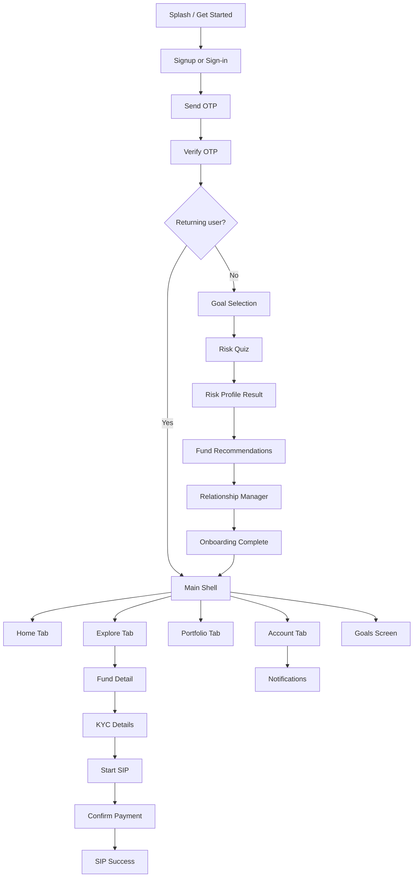

# Neev Money — Backend API Specification

> **Audience:** Backend engineering team  
> **Source of truth:** Flutter mobile client (`lib/`) — models, connect helpers, and app routing  
> **Version:** v1  
> **Last updated:** September 2026

This document defines the REST API contract the mobile app expects. Endpoints are ordered **sequentially by user journey** (matching app routing), not alphabetically.

---

## Table of Contents

1. [Conventions](#1-conventions)
2. [Flow Overview](#2-flow-overview)
3. [Phase 1 — Onboarding & Auth](#3-phase-1--onboarding--auth)
4. [Phase 2 — Main App Shell](#4-phase-2--main-app-shell)
5. [Phase 3 — Fund Detail & SIP Flow](#5-phase-3--fund-detail--sip-flow)
6. [Phase 4 — Goals & Notifications](#6-phase-4--goals--notifications)
7. [Shared Schemas](#7-shared-schemas)
8. [Error Handling](#8-error-handling)
9. [Client Integration Notes](#9-client-integration-notes)

---

## 1. Conventions

| Item | Value |
|------|-------|
| **Base URL** | `https://api.neevmoney.com/v1` |
| **Content-Type** | `application/json` |
| **Auth header** | `Authorization: Bearer <jwt_token>` (required on protected routes) |
| **JSON casing** | `camelCase` (matches Flutter `json_serializable` models) |
| **Dates** | ISO 8601 strings, e.g. `"2026-04-11T00:00:00.000Z"` |
| **Phone** | 10-digit Indian mobile without country code in request; E.164 in responses is acceptable |
| **Currency** | INR; amounts are numbers (not strings), e.g. `5000.0` |
| **Timeouts** | Connect 30s, receive 30s |

### Standard success envelope (recommended)

```json
{
  "success": true,
  "data": { }
}
```

### Standard error envelope (required — client reads `message`)

```json
{
  "success": false,
  "message": "Human-readable error description"
}
```

---

## 2. Flow Overview

The mobile app navigates in this order. Backend endpoints should be callable in the same sequence.



| App route | Path | APIs used |
|-----------|------|-----------|
| `/` (splash) | Onboarding shell | — |
| Signup / OTP | Onboarding | `POST /auth/otp/send`, `POST /auth/otp/verify` |
| Goal select → Quiz → RM | Onboarding | Goals, risk, recommendations, RM APIs |
| `/main` | Main shell (tabs) | `GET /users/me`, `GET /portfolio`, `GET /funds` |
| `/fund-detail` | Fund detail | `GET /funds/:id` |
| `/kyc-details` | KYC form | `GET /users/me/kyc`, `POST /users/me/kyc` |
| `/start-sip` | SIP setup | `GET /funds/:id`, `GET /payment-methods` |
| `/confirm-pay` | Payment confirm | `POST /sips` |
| `/success` | SIP confirmation | (response from `POST /sips`) |
| `/goals` | Goals | `GET /users/me/goals`, `PUT /users/me/goals/:id` |
| `/notifications` | Notifications | `GET /notifications`, `PATCH /notifications` |

---

## 3. Phase 1 — Onboarding & Auth

### 3.1 Send OTP

Triggered when user submits phone on signup/sign-in screen.

```
POST /auth/otp/send
```

**Auth:** None

**Request body:**

```json
{
  "phone": "9876543210"
}
```

| Field | Type | Required | Validation |
|-------|------|----------|------------|
| `phone` | string | Yes | Exactly 10 digits |

**Response `200 OK`:**

```json
{
  "success": true,
  "data": {
    "message": "OTP sent successfully",
    "expiresInSeconds": 300
  }
}
```

**Response `400 Bad Request`:**

```json
{
  "success": false,
  "message": "Invalid phone number"
}
```

---

### 3.2 Verify OTP

Triggered when user enters 6-digit OTP. Returns JWT for all subsequent calls.

```
POST /auth/otp/verify
```

**Auth:** None

**Request body:**

```json
{
  "phone": "9876543210",
  "otp": "123456",
  "name": "Shaira"
}
```

| Field | Type | Required | Notes |
|-------|------|----------|-------|
| `phone` | string | Yes | Same as send OTP |
| `otp` | string | Yes | 6 digits |
| `name` | string | No | Required for new signup; optional for returning sign-in |

**Response `200 OK`:**

```json
{
  "success": true,
  "data": {
    "token": "eyJhbGciOiJIUzI1NiIsInR5cCI6IkpXVCJ9...",
    "isNewUser": true,
    "user": {
      "id": "1",
      "name": "Shaira",
      "email": "",
      "phone": "+919876543210",
      "isKycVerified": false
    }
  }
}
```

**Response `400 Bad Request`:**

```json
{
  "success": false,
  "message": "Invalid OTP"
}
```

> **Client behavior:** Stores `token` in secure storage. Attaches `Authorization: Bearer <token>` on every request via Dio interceptor.

---

### 3.3 Resend OTP

Triggered from OTP screen "Resend" action.

```
POST /auth/otp/resend
```

**Auth:** None

**Request body:**

```json
{
  "phone": "9876543210"
}
```

**Response `200 OK`:**

```json
{
  "success": true,
  "data": {
    "message": "OTP resent successfully",
    "expiresInSeconds": 300
  }
}
```

---

### 3.4 Save Onboarding Goals

Triggered after goal multi-select (before risk quiz). User may select multiple goals.

```
POST /users/me/goals
```

**Auth:** Bearer token

**Request body:**

```json
{
  "goals": [
    {
      "goalId": "home",
      "label": "Home",
      "amountValue": 0,
      "amountLabel": "TBD",
      "tenureLabel": "TBD"
    },
    {
      "goalId": "retirement",
      "label": "Retirement",
      "amountValue": 0,
      "amountLabel": "TBD",
      "tenureLabel": "TBD"
    }
  ]
}
```

| Field | Type | Required | Notes |
|-------|------|----------|-------|
| `goals[].goalId` | string | Yes | One of: `home`, `travel`, `education`, `retirement`, `wealth_creation`, `emergency`, `other` |
| `goals[].label` | string | Yes | Display label |
| `goals[].amountValue` | number | No | Target amount in INR; `0` if TBD |
| `goals[].amountLabel` | string | No | e.g. `"₹10L"` or `"TBD"` |
| `goals[].tenureLabel` | string | No | e.g. `"5–10 yrs"` or `"TBD"` |

**Response `201 Created`:**

```json
{
  "success": true,
  "data": {
    "goals": [
      {
        "id": "goal_abc123",
        "goalId": "home",
        "label": "Home",
        "amountValue": 0,
        "amountLabel": "TBD",
        "tenureLabel": "TBD",
        "progressPercent": 0,
        "createdAt": "2026-09-02T10:00:00.000Z"
      }
    ]
  }
}
```

---

### 3.5 Submit Risk Assessment Quiz

Triggered after user completes all 3 quiz questions.

```
POST /users/me/risk-assessment
```

**Auth:** Bearer token

**Request body:**

```json
{
  "answers": [
    { "questionIndex": 0, "score": 2 },
    { "questionIndex": 1, "score": 3 },
    { "questionIndex": 2, "score": 2 }
  ]
}
```

| Field | Type | Required | Notes |
|-------|------|----------|-------|
| `answers[].questionIndex` | integer | Yes | 0-based index (0–2) |
| `answers[].score` | integer | Yes | 1 = Conservative, 2 = Balanced, 3 = Aggressive |

**Response `200 OK`:**

```json
{
  "success": true,
  "data": {
    "totalScore": 7,
    "riskBand": {
      "key": "BALANCED",
      "label": "Balanced",
      "description": "You're happy to ride short-term ups and downs for stronger long-term growth — so we lean toward equity, with a debt cushion.",
      "equityPct": 55,
      "hybridPct": 15,
      "debtPct": 30
    }
  }
}
```

**Risk band mapping (client logic):**

| Total score | Band key | Label |
|-------------|----------|-------|
| 3–4 | `CONSERVATIVE` | Conservative |
| 5 | `MODERATE` | Steady Builder |
| 6–7 | `BALANCED` | Balanced |
| 8 | `GROWTH` | Growth Seeker |
| 9 | `AGGRESSIVE` | Aggressive |

---

### 3.6 Get Fund Recommendations

Triggered on "Your plan" screen after risk result. Allocation based on risk band.

```
GET /funds/recommended
```

**Auth:** Bearer token

**Query params:** None (uses stored risk profile)

**Response `200 OK`:**

```json
{
  "success": true,
  "data": {
    "allocation": {
      "equityPct": 55,
      "hybridPct": 15,
      "debtPct": 30
    },
    "recommendations": [
      {
        "bucket": "equity",
        "fund": {
          "id": "1",
          "name": "Parag Parikh Flexi Cap",
          "shortCode": "PP",
          "category": "Flexi Cap",
          "riskLevel": "Very high risk",
          "returns3Y": 16.2,
          "minSip": 1000,
          "nav": 74.82,
          "expenseRatio": 1.44,
          "fundSize": 84910,
          "planType": "Direct · Growth · Flexi Cap",
          "rating": 5,
          "holdings": [
            { "name": "HDFC Bank", "percentage": 7.8 },
            { "name": "Bajaj Holdings", "percentage": 5.6 }
          ]
        },
        "suggestedMonthlyAmount": 5000
      },
      {
        "bucket": "hybrid",
        "fund": {
          "id": "3",
          "name": "Neev Index Fund",
          "shortCode": "NI",
          "category": "Index",
          "riskLevel": "Moderate",
          "returns3Y": 13.8,
          "minSip": 500,
          "nav": 24.56,
          "expenseRatio": 0.35,
          "fundSize": 15600,
          "planType": "Direct · Growth",
          "rating": 4.8,
          "holdings": []
        },
        "suggestedMonthlyAmount": 2000
      },
      {
        "bucket": "debt",
        "fund": {
          "id": "4",
          "name": "Neev Debt Fund",
          "shortCode": "ND",
          "category": "Debt",
          "riskLevel": "Low",
          "returns3Y": 7.2,
          "minSip": 500,
          "nav": 15.89,
          "expenseRatio": 0.45,
          "fundSize": 3200,
          "planType": "Direct · Growth",
          "rating": 4.2,
          "holdings": []
        },
        "suggestedMonthlyAmount": 1500
      }
    ]
  }
}
```

---

### 3.7 List Relationship Managers

Triggered on RM selection screen.

```
GET /relationship-managers
```

**Auth:** Bearer token

**Query params (optional):**

| Param | Type | Description |
|-------|------|-------------|
| `riskBand` | string | Filter by matching band, e.g. `BALANCED` |

**Response `200 OK`:**

```json
{
  "success": true,
  "data": {
    "managers": [
      {
        "id": "ananya",
        "name": "Ananya Rao",
        "initials": "AR",
        "credentials": "CFP · 9 yrs experience",
        "base": "Mumbai",
        "focus": "Balanced & growth portfolios",
        "matches": ["BALANCED", "GROWTH"]
      },
      {
        "id": "vikram",
        "name": "Vikram Shah",
        "initials": "VS",
        "credentials": "CFA · 12 yrs experience",
        "base": "Bengaluru",
        "focus": "Conservative & retirement planning",
        "matches": ["CONSERVATIVE", "MODERATE"]
      },
      {
        "id": "priya",
        "name": "Priya Menon",
        "initials": "PM",
        "credentials": "CFP · 6 yrs experience",
        "base": "Delhi NCR",
        "focus": "Goal-based & aggressive growth",
        "matches": ["GROWTH", "AGGRESSIVE"]
      }
    ],
    "recommendedId": "ananya"
  }
}
```

---

### 3.8 Assign Relationship Manager

Triggered when user confirms RM selection.

```
POST /users/me/relationship-manager
```

**Auth:** Bearer token

**Request body:**

```json
{
  "managerId": "ananya"
}
```

**Response `200 OK`:**

```json
{
  "success": true,
  "data": {
    "managerId": "ananya",
    "assignedAt": "2026-09-02T10:15:00.000Z"
  }
}
```

---

### 3.9 Complete Onboarding

Triggered when user finishes onboarding success screen and enters main app.

```
POST /users/me/onboarding/complete
```

**Auth:** Bearer token

**Request body:**

```json
{}
```

**Response `200 OK`:**

```json
{
  "success": true,
  "data": {
    "onboardingCompleted": true,
    "completedAt": "2026-09-02T10:20:00.000Z"
  }
}
```

---

## 4. Phase 2 — Main App Shell

Route: `/main` — loads Home, Explore, and Portfolio tabs in parallel.

---

### 4.1 Get Current User

Used by Home tab and Account tab.

```
GET /users/me
```

**Auth:** Bearer token

**Response `200 OK`:**

```json
{
  "success": true,
  "data": {
    "id": "1",
    "name": "Shaira",
    "email": "shaira@email.com",
    "phone": "+919876543210",
    "isKycVerified": true
  }
}
```

**Response `401 Unauthorized`:**

```json
{
  "success": false,
  "message": "Unauthorized"
}
```

---

### 4.2 Get Portfolio Summary

Used by Home and Portfolio tabs.

```
GET /portfolio
```

**Auth:** Bearer token

**Response `200 OK`:**

```json
{
  "success": true,
  "data": {
    "currentValue": 486240,
    "investedAmount": 425000,
    "totalReturns": 61240,
    "totalReturnsPercent": 14.4,
    "oneDayChange": 1842,
    "oneDayChangePercent": 0.38,
    "allocation": [
      { "name": "Flexi Cap", "percentage": 40 },
      { "name": "Small Cap", "percentage": 31 },
      { "name": "Index", "percentage": 29 }
    ],
    "holdings": [
      {
        "fundId": "1",
        "fundName": "Parag Parikh Flexi Cap",
        "currentValue": 194496,
        "dailyChange": 936,
        "dailyChangePercent": 0.48,
        "profitLoss": 28496,
        "profitLossPercent": 17.1
      },
      {
        "fundId": "2",
        "fundName": "HDFC Small Cap Fund",
        "currentValue": 150734,
        "dailyChange": 725,
        "dailyChangePercent": 0.48,
        "profitLoss": 20734,
        "profitLossPercent": 15.9
      },
      {
        "fundId": "3",
        "fundName": "Neev Index Fund",
        "currentValue": 141010,
        "dailyChange": 681,
        "dailyChangePercent": 0.48,
        "profitLoss": 12010,
        "profitLossPercent": 9.3
      }
    ]
  }
}
```

---

### 4.3 List Funds

Used by Home (top 3), Explore (full list + filters).

```
GET /funds
```

**Auth:** Bearer token

**Query params:**

| Param | Type | Required | Description |
|-------|------|----------|-------------|
| `category` | string | No | Filter by category. Omit or `"For you"` returns all funds. Values: `Equity`, `Debt`, `Hybrid`, `ELSS`, or exact category name like `Flexi Cap`, `Small Cap`, `Index` |

**Example:** `GET /funds?category=ELSS`

**Response `200 OK`:**

```json
{
  "success": true,
  "data": {
    "funds": [
      {
        "id": "1",
        "name": "Parag Parikh Flexi Cap",
        "shortCode": "PP",
        "category": "Flexi Cap",
        "riskLevel": "Very high risk",
        "returns3Y": 16.2,
        "minSip": 1000,
        "nav": 74.82,
        "expenseRatio": 1.44,
        "fundSize": 84910,
        "planType": "Direct · Growth · Flexi Cap",
        "rating": 5,
        "holdings": [
          { "name": "HDFC Bank", "percentage": 7.8 },
          { "name": "Bajaj Holdings", "percentage": 5.6 },
          { "name": "Infosys", "percentage": 4.9 },
          { "name": "ITC", "percentage": 4.2 }
        ]
      },
      {
        "id": "2",
        "name": "HDFC Small Cap Fund",
        "shortCode": "HD",
        "category": "Small Cap",
        "riskLevel": "Very high risk",
        "returns3Y": 22.4,
        "minSip": 1000,
        "nav": 128.15,
        "expenseRatio": 1.68,
        "fundSize": 32100,
        "planType": "Direct · Growth",
        "rating": 4.5,
        "holdings": [
          { "name": "Persistent Systems", "percentage": 3.8 },
          { "name": "Coforge", "percentage": 3.5 },
          { "name": "Titan Company", "percentage": 3.2 }
        ]
      }
    ],
    "filterTags": ["For you", "Equity", "Debt", "Hybrid", "ELSS"]
  }
}
```

> **Note:** Search/filter by fund name is done **client-side** in Explore tab. Backend only needs category filter.

---

## 5. Phase 3 — Fund Detail & SIP Flow

Sequential flow: `/fund-detail` → `/kyc-details` → `/start-sip` → `/confirm-pay` → `/success`

---

### 5.1 Get Fund by ID

Triggered when user opens fund detail screen.

```
GET /funds/:id
```

**Auth:** Bearer token

**Path params:**

| Param | Type | Example |
|-------|------|---------|
| `id` | string | `1` |

**Response `200 OK`:**

```json
{
  "success": true,
  "data": {
    "id": "1",
    "name": "Parag Parikh Flexi Cap",
    "shortCode": "PP",
    "category": "Flexi Cap",
    "riskLevel": "Very high risk",
    "returns3Y": 16.2,
    "minSip": 1000,
    "nav": 74.82,
    "expenseRatio": 1.44,
    "fundSize": 84910,
    "planType": "Direct · Growth · Flexi Cap",
    "rating": 5,
    "holdings": [
      { "name": "HDFC Bank", "percentage": 7.8 },
      { "name": "Bajaj Holdings", "percentage": 5.6 },
      { "name": "Infosys", "percentage": 4.9 },
      { "name": "ITC", "percentage": 4.2 }
    ]
  }
}
```

**Response `404 Not Found`:**

```json
{
  "success": false,
  "message": "Fund not found"
}
```

---

### 5.2 Get KYC Status

Triggered when user enters KYC details screen (before SIP).

```
GET /users/me/kyc
```

**Auth:** Bearer token

**Response `200 OK`:**

```json
{
  "success": true,
  "data": {
    "status": "pending",
    "isVerified": false,
    "prefill": {
      "pan": "ABCDE1234F",
      "name": "Aarav Mehta",
      "dateOfBirth": "1994-03-14",
      "email": "aarav.mehta@gmail.com",
      "gender": "Male"
    }
  }
}
```

| `status` values | Description |
|-----------------|-------------|
| `not_started` | No KYC submitted |
| `pending` | Submitted, awaiting verification |
| `verified` | KYC complete |
| `rejected` | KYC failed — user must resubmit |

---

### 5.3 Submit KYC Details

Triggered when user submits KYC form and proceeds to Start SIP.

```
POST /users/me/kyc
```

**Auth:** Bearer token

**Request body:**

```json
{
  "pan": "ABCDE1234F",
  "name": "Aarav Mehta",
  "dateOfBirth": "1994-03-14",
  "email": "aarav.mehta@gmail.com",
  "gender": "Male"
}
```

| Field | Type | Required | Validation |
|-------|------|----------|------------|
| `pan` | string | Yes | Valid PAN format |
| `name` | string | Yes | Full legal name |
| `dateOfBirth` | string | Yes | ISO date `YYYY-MM-DD` |
| `email` | string | Yes | Valid email |
| `gender` | string | Yes | `Male`, `Female`, `Other` |

**Response `200 OK`:**

```json
{
  "success": true,
  "data": {
    "status": "pending",
    "isVerified": false,
    "submittedAt": "2026-09-02T11:00:00.000Z"
  }
}
```

---

### 5.4 List Payment Methods

Triggered on Start SIP / Confirm Pay screens.

```
GET /payment-methods
```

**Auth:** Bearer token

**Response `200 OK`:**

```json
{
  "success": true,
  "data": {
    "methods": [
      {
        "id": "upi_gpay",
        "type": "upi",
        "label": "Google Pay",
        "maskedDetail": "shaira@okhdfcbank"
      },
      {
        "id": "bank_hdfc",
        "type": "bank",
        "label": "HDFC Bank",
        "maskedDetail": "**** 4521"
      }
    ],
    "defaultMethodId": "upi_gpay"
  }
}
```

---

### 5.5 Create SIP

Triggered on Confirm Pay screen when user confirms payment.

```
POST /sips
```

**Auth:** Bearer token

**Request body:**

```json
{
  "fundId": "1",
  "fundName": "Parag Parikh Flexi Cap",
  "amount": 5000,
  "debitDay": 11,
  "paymentMethod": "upi_gpay",
  "projectedValue": 1150000
}
```

| Field | Type | Required | Notes |
|-------|------|----------|-------|
| `fundId` | string | Yes | Fund identifier |
| `fundName` | string | Yes | Denormalized for confirmation screen |
| `amount` | number | Yes | Monthly SIP amount in INR; must be ≥ fund `minSip` |
| `debitDay` | integer | Yes | Day of month (1–28) |
| `paymentMethod` | string | Yes | Payment method ID from `GET /payment-methods` |
| `projectedValue` | number | No | Client-calculated projection; informational only |

**Response `201 Created`:**

```json
{
  "success": true,
  "data": {
    "folioNumber": "NEV48291",
    "nextDebitDate": "2026-10-11T00:00:00.000Z",
    "amount": 5000,
    "fundName": "Parag Parikh Flexi Cap"
  }
}
```

**Response `400 Bad Request`:**

```json
{
  "success": false,
  "message": "Payment failed"
}
```

> **Client behavior:** Navigates to `/success` with `SipConfirmation` payload.

---

## 6. Phase 4 — Goals & Notifications

---

### 6.1 Get User Goals

Triggered on Goals screen (`/goals`).

```
GET /users/me/goals
```

**Auth:** Bearer token

**Response `200 OK`:**

```json
{
  "success": true,
  "data": {
    "goals": [
      {
        "id": "goal_abc123",
        "goalId": "home",
        "label": "Home",
        "amountValue": 2500000,
        "amountLabel": "₹25L",
        "tenureLabel": "5–10 yrs",
        "progressPercent": 12,
        "linkedSipId": "sip_xyz789",
        "createdAt": "2026-09-02T10:00:00.000Z"
      }
    ]
  }
}
```

---

### 6.2 Update Goal

Triggered when user edits goal amount/tenure from Goals screen.

```
PUT /users/me/goals/:id
```

**Auth:** Bearer token

**Request body:**

```json
{
  "amountValue": 5000000,
  "amountLabel": "₹50L",
  "tenureLabel": "10+ yrs"
}
```

**Response `200 OK`:**

```json
{
  "success": true,
  "data": {
    "id": "goal_abc123",
    "goalId": "home",
    "label": "Home",
    "amountValue": 5000000,
    "amountLabel": "₹50L",
    "tenureLabel": "10+ yrs",
    "progressPercent": 6,
    "updatedAt": "2026-09-02T12:00:00.000Z"
  }
}
```

---

### 6.3 Link SIP to Goal

Triggered from SIP success screen → "Link to goal".

```
POST /users/me/goals/:id/link-sip
```

**Auth:** Bearer token

**Request body:**

```json
{
  "sipId": "sip_xyz789"
}
```

**Response `200 OK`:**

```json
{
  "success": true,
  "data": {
    "goalId": "goal_abc123",
    "sipId": "sip_xyz789",
    "linkedAt": "2026-09-02T12:30:00.000Z"
  }
}
```

---

### 6.4 List Notifications

Triggered on Notifications screen (`/notifications`).

```
GET /notifications
```

**Auth:** Bearer token

**Query params (optional):**

| Param | Type | Description |
|-------|------|-------------|
| `unreadOnly` | boolean | Return only unread items |

**Response `200 OK`:**

```json
{
  "success": true,
  "data": {
    "notifications": [
      {
        "id": "1",
        "kind": "sip",
        "title": "SIP due tomorrow",
        "body": "₹5,000 will be debited for Parag Parikh Flexi Cap on 11 Apr.",
        "timeLabel": "2h ago",
        "createdAt": "2026-09-02T09:00:00.000Z",
        "unread": true
      },
      {
        "id": "2",
        "kind": "goal",
        "title": "Home goal on track",
        "body": "You're 12% closer this quarter. Keep your SIP running.",
        "timeLabel": "5h ago",
        "createdAt": "2026-09-02T06:00:00.000Z",
        "unread": true
      },
      {
        "id": "3",
        "kind": "market",
        "title": "Markets closed higher",
        "body": "Nifty +0.8%. Your equity sleeve is up about ₹1,240 today.",
        "timeLabel": "Yesterday",
        "createdAt": "2026-09-01T16:00:00.000Z",
        "unread": true
      },
      {
        "id": "4",
        "kind": "kyc",
        "title": "KYC reminder",
        "body": "Finish e-sign to start investing without delays.",
        "timeLabel": "Yesterday",
        "createdAt": "2026-09-01T10:00:00.000Z",
        "unread": false
      }
    ],
    "unreadCount": 3
  }
}
```

**Notification `kind` enum:** `sip`, `goal`, `market`, `kyc`, `security`, `promo`

---

### 6.5 Mark Notifications Read

Triggered when user opens a notification or taps "Mark all read".

```
PATCH /notifications
```

**Auth:** Bearer token

**Request body (mark all):**

```json
{
  "action": "mark_all_read"
}
```

**Request body (mark single):**

```json
{
  "action": "mark_read",
  "notificationIds": ["1"]
}
```

**Response `200 OK`:**

```json
{
  "success": true,
  "data": {
    "unreadCount": 0
  }
}
```

---

### 6.6 Clear All Notifications

Triggered from "Clear all" action on Notifications screen.

```
DELETE /notifications
```

**Auth:** Bearer token

**Response `200 OK`:**

```json
{
  "success": true,
  "data": {
    "deletedCount": 6
  }
}
```

---

## 7. Shared Schemas

### UserModel

```json
{
  "id": "string",
  "name": "string",
  "email": "string",
  "phone": "string",
  "isKycVerified": false
}
```

### FundModel

```json
{
  "id": "string",
  "name": "string",
  "category": "string",
  "riskLevel": "string",
  "returns3Y": 0.0,
  "minSip": 0.0,
  "nav": 0.0,
  "expenseRatio": 0.0,
  "fundSize": 0.0,
  "shortCode": "",
  "planType": "Direct · Growth",
  "rating": 4.5,
  "holdings": [{ "name": "string", "percentage": 0.0 }]
}
```

### PortfolioSummary

```json
{
  "currentValue": 0.0,
  "investedAmount": 0.0,
  "totalReturns": 0.0,
  "totalReturnsPercent": 0.0,
  "oneDayChange": 0.0,
  "oneDayChangePercent": 0.0,
  "allocation": [{ "name": "string", "percentage": 0.0 }],
  "holdings": [{
    "fundId": "string",
    "fundName": "string",
    "currentValue": 0.0,
    "dailyChange": 0.0,
    "dailyChangePercent": 0.0,
    "profitLoss": 0.0,
    "profitLossPercent": 0.0
  }]
}
```

### SipModel (request)

```json
{
  "fundId": "string",
  "fundName": "string",
  "amount": 0.0,
  "debitDay": 1,
  "paymentMethod": "string",
  "projectedValue": 0.0
}
```

### SipConfirmation (response)

```json
{
  "folioNumber": "string",
  "nextDebitDate": "2026-04-11T00:00:00.000Z",
  "amount": 0.0,
  "fundName": "string"
}
```

---

## 8. Error Handling

The mobile client maps HTTP errors as follows (see `lib/data/remote/api/api_helper.dart`):

| HTTP Status | Client handling | Expected response |
|-------------|-----------------|-------------------|
| **401** | `AppFailure.unauthorized()` — redirect to login | `{ "message": "Unauthorized" }` |
| **404** | `AppFailure.notFound()` | `{ "message": "Resource not found" }` |
| **400, 422, 5xx** | `AppFailure.serverError(message)` | `{ "message": "<specific reason>" }` |
| **Timeout / network** | `AppFailure.connectionFailure()` | — |

Always include a `message` field in error responses.

---

## 9. Client Integration Notes

### Current state

The Flutter app currently uses **mock data** (`FundConnectHelper`, `AuthConnectHelper`) and does **not** call these endpoints yet. The HTTP layer (`DioClient`, `ApiHelper`) is ready and will attach Bearer tokens automatically once wired.

### Endpoint summary (call order)

| # | Method | Path | Auth | App screen |
|---|--------|------|------|------------|
| 1 | POST | `/auth/otp/send` | No | Signup |
| 2 | POST | `/auth/otp/verify` | No | OTP verify |
| 3 | POST | `/auth/otp/resend` | No | OTP resend |
| 4 | POST | `/users/me/goals` | Yes | Goal select |
| 5 | POST | `/users/me/risk-assessment` | Yes | Risk quiz |
| 6 | GET | `/funds/recommended` | Yes | Fund recommendations |
| 7 | GET | `/relationship-managers` | Yes | RM select |
| 8 | POST | `/users/me/relationship-manager` | Yes | RM confirm |
| 9 | POST | `/users/me/onboarding/complete` | Yes | Onboarding success |
| 10 | GET | `/users/me` | Yes | Home / Account |
| 11 | GET | `/portfolio` | Yes | Home / Portfolio |
| 12 | GET | `/funds` | Yes | Home / Explore |
| 13 | GET | `/funds/:id` | Yes | Fund detail |
| 14 | GET | `/users/me/kyc` | Yes | KYC details |
| 15 | POST | `/users/me/kyc` | Yes | KYC submit |
| 16 | GET | `/payment-methods` | Yes | Start SIP |
| 17 | POST | `/sips` | Yes | Confirm pay |
| 18 | GET | `/users/me/goals` | Yes | Goals |
| 19 | PUT | `/users/me/goals/:id` | Yes | Edit goal |
| 20 | POST | `/users/me/goals/:id/link-sip` | Yes | SIP success |
| 21 | GET | `/notifications` | Yes | Notifications |
| 22 | PATCH | `/notifications` | Yes | Mark read |
| 23 | DELETE | `/notifications` | Yes | Clear all |

### Source files for backend reference

| Purpose | Path |
|---------|------|
| Base URL config | `lib/data/local/api_config.dart` |
| Auth interceptor | `lib/data/remote/api/dio_client.dart` |
| Error mapping | `lib/data/remote/api/api_helper.dart` |
| Data models | `lib/domain/models/` |
| Mock response samples | `lib/data/local/mock_data.dart` |
| App routing | `lib/router/route_manager.dart` |
